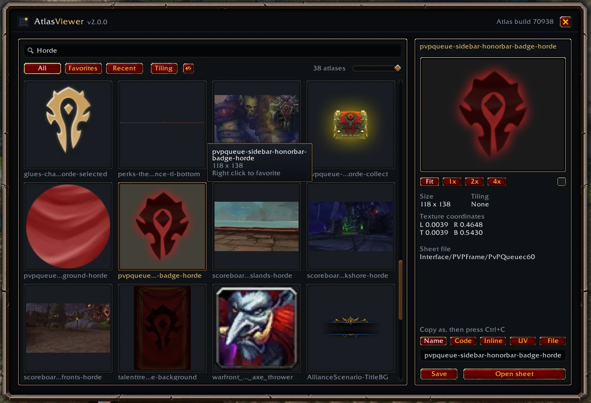
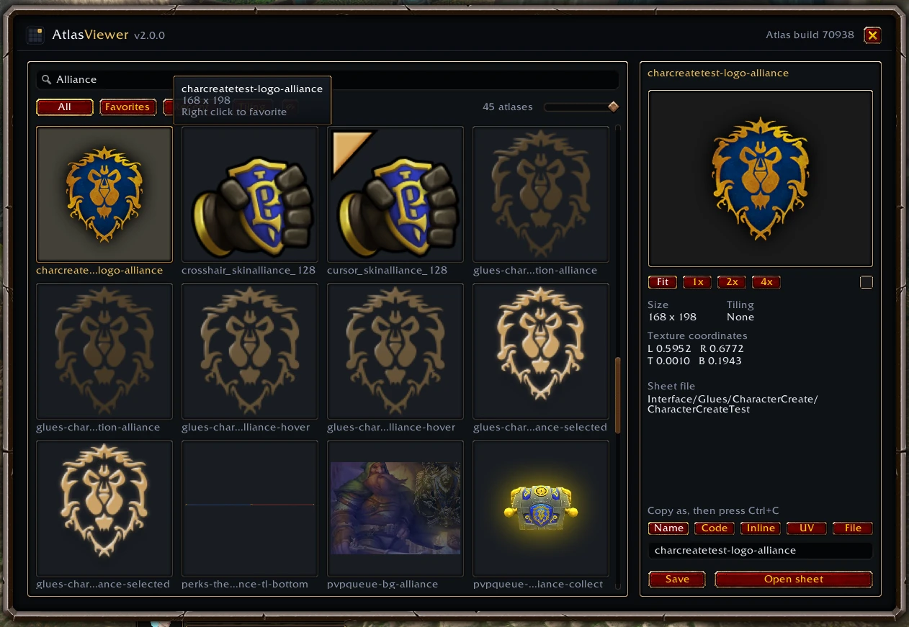
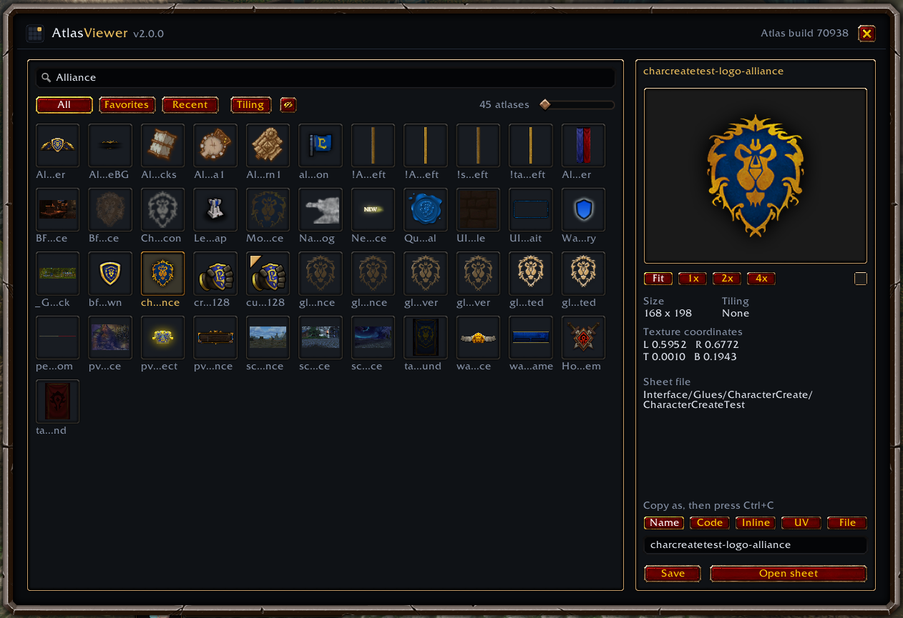

# AtlasViewer

A texture atlas browser for World of Warcraft. Search every atlas the game knows, see what it looks like, and copy the name or the code to use it.

## What it does

- Searches atlas names and file paths as you type, with name matches ranked ahead of path matches.
- Shows results as a grid of real thumbnails, so you find the right art by sight.
- Opens a detail drawer with a large preview, size, tiling and texture coordinates.
- Copies an atlas as its name, a `SetAtlas` call, a `CreateAtlasMarkup` call, UV coordinates or the file path.
- Opens the whole texture file in a sheet view, with every atlas outlined, clickable and zoomable.
- Keeps favorites and recent picks, and filters to tiling atlases or atlases the client no longer resolves.
- Builds its look from art that ships with the game, so the window matches the client and falls back to flat widgets where a client lacks a piece.

## Screenshots

## Supported clients

- Retail, Classic Era, Mists of Pandaria Classic and WoW Forever each ship their own atlas data.
- The TOC also lists TBC, Wrath and Cata. Those clients read the atlas list from the game itself, which has not been tested there.

## Get it

Download the latest release from the [Releases](https://github.com/Kkthnx-Wow/AtlasViewer/releases) page and extract the `AtlasViewer` folder into your `Interface/AddOns` folder for the client you play.

## Quick start

1. Install the addon and restart the game, or `/reload`.
2. Open the window with `/av` or `/atlasviewer`. Add text to search straight away, for example `/av button`.
3. Click a thumbnail to see its details. Right click one to save it as a favorite.
4. Use the arrow keys, Page Up and Page Down to move through the grid.
5. Choose Open sheet to see the atlas in its texture file.

The window closes when you enter combat and when you press Escape. Drag the header to move it, and drag any edge or corner to resize it.

## Keeping the atlas data current

Each game type has a data file under `AtlasViewer/Data`. After a patch you can rebuild it from the game itself.

1. In game, type `/av dump`. This saves every atlas your client knows.
2. Type `/reload` or log out so the game writes the file.
3. Run `tools/update_atlas_data.cmd`, or `python tools/update_atlas_data.py --from-client`.

The dump always matches the build you are playing. Run `/av dump clear` to remove it from your saved variables. `/av probe` reports which window art your client resolved.

## Support the work

Free forever. If it saved you time, chip in.

- [Ko-fi](https://ko-fi.com/kkthnx)
- [Buy Me a Coffee](https://buymeacoffee.com/kkthnx)
- [PayPal](https://www.paypal.com/paypalme/kkthnxtv)

Every bit goes back into building more.

## Community

- Glitch Haven Discord at https://discord.gg/FaVGhTYmck
- Website at https://kkthnx.com

## License

All Rights Reserved. See LICENSE for details.
